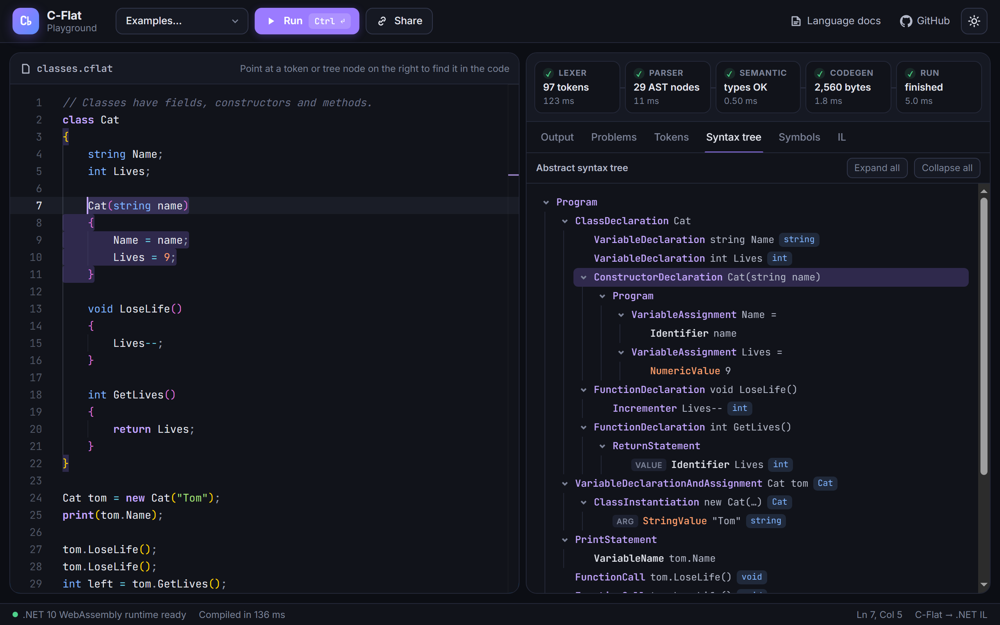
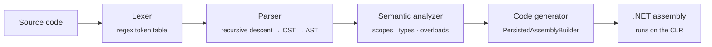

<div align="center">

# C♭ &nbsp;C-Flat

**A C#-inspired programming language with a hand-written compiler that emits real .NET IL.**

### [▶&nbsp; Try it in your browser](https://nikitaulianov123.github.io/C-Flat_Compiler/)

[Language documentation](DOCS.md) · [How the compiler works](#how-the-compiler-works) · [Run it locally](#build-and-run-locally)

[](https://github.com/NikitaUlianov123/C-Flat_Compiler/actions/workflows/playground.yml)

[](LICENSE)

<a href="https://nikitaulianov123.github.io/C-Flat_Compiler/">
  
</a>

</div>

## The playground

The [playground](https://nikitaulianov123.github.io/C-Flat_Compiler/) runs **this repository's compiler** in your browser on .NET WebAssembly. There is nothing to install, and no server compiles your code.

- **Write and run** C-Flat with syntax colors, snippets and red squiggles for compile errors. Press <kbd>Ctrl</kbd>+<kbd>Enter</kbd> to run.
- **Look inside every stage**: the token stream, the abstract syntax tree (with the types the analyzer found), the classes and methods it resolved, and the CIL that the code generator emitted.
- **Point at any token or tree node** to find it in the source.
- **Share** a program with one link, or **download** the compiled assembly and open it in ILSpy.
- Start from one of the **examples**: FizzBuzz, classes, a linked list, `goto`, and a program that has mistakes on purpose.

## A taste of C-Flat

```csharp
class Counter
{
    int Count;

    void Tick()
    {
        Count++;
    }
}

Counter clock = new Counter();
clock.Tick();
clock.Tick();
print(clock.Count);             // 2

ifn't(clock.Count =? 0)         // runs when the condition is FALSE
{
    print("The clock ticked");
}

int tries = 5;
while(tries < 3)
{
    tries++;
}
else                            // runs only if the loop body never ran
{
    print("The loop never ran");
}
```

Equality is `=?`, there is an `ifn't`, and loops can have an `else`. The [language documentation](DOCS.md) has the full tour and the grammar.

## How the compiler works



| Stage | File | What it does |
|---|---|---|
| Lexer | [`Lexer.cs`](Compiler/Compiler/Lexer.cs), [`Token.cs`](Compiler/Compiler/Token.cs) | Turns the text into tokens with an ordered table of regular expressions. |
| Parser | [`Parser.cs`](Compiler/Compiler/Parser.cs) | Matches the grammar productions to build a concrete syntax tree, then collapses and hoists it into an AST. |
| Semantic analyzer | [`SemanticAnalyzer.cs`](Compiler/Compiler/SemanticAnalyzer.cs) | Collects classes, fields and methods, checks scopes and types, and resolves overloads. |
| Code generator | [`CodeGen.cs`](Compiler/Compiler/CodeGen.cs) | Emits CIL with `System.Reflection.Emit` and saves a real PE assembly. |

## Build and run locally

You need the [.NET 10 SDK](https://dotnet.microsoft.com/download).

```sh
# The compiler and its tests
dotnet test Compiler/Compiler.sln

# The playground (prints a local URL to open)
cd Playground
dotnet run
```

Every push to `main` publishes the playground to GitHub Pages with [this workflow](.github/workflows/playground.yml). [`Playground/README.md`](Playground/README.md) explains how the playground is built.

## Project layout

```
Compiler/
  Compiler/       the compiler: lexer, parser, semantic analyzer, code generator
  TestProject/    MSTest unit tests
Playground/       the browser playground (.NET WebAssembly + Monaco editor)
DOCS.md           the language documentation
```

## Language status

**Fully implemented**

- [x] variables
- [x] print
- [x] if
- [x] while
- [x] ifn't
- [x] else
- [x] else if
- [x] for
- [x] comments (only single line `//`)
- [x] goto
- [x] void functions
- [x] while, else
- [x] `++` and `--`
- [x] function parameters
- [x] return functions
- [x] classes
- [x] functions in classes
- [x] function overloads

**To do**

- [ ] "not all code paths return a value"
- [ ] class function access modifiers
- [ ] properties
- [ ] inheritance
- [ ] abstract classes
- [ ] interfaces
- [ ] static
- [ ] generics
- [ ] string interpolation
- [ ] go away statement (break out of all loops)
- [ ] do while and do for
- [ ] arrays
- [ ] type inference? (`var`)
- [ ] delegates (func/action)
- [ ] user input

## License

[MIT](LICENSE)
